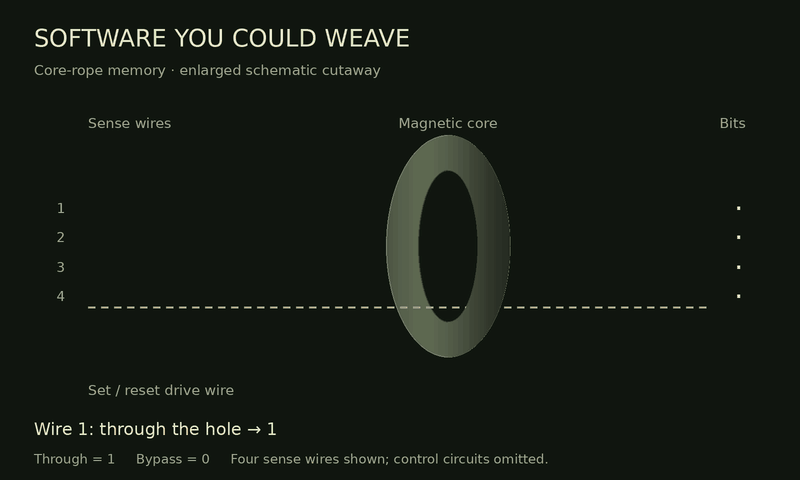

# Apollo Rope Lab

Hardware coupling checkpoint for Andy J Myers. A playable teaching model, an original AGC workbench and a sensor/engine experiment. Static HTML/CSS/JavaScript/WebAssembly; all runtime assets are served locally by the Site.

## In The News

*A moon-dew stars her hanging hair*

[Image source: Silver Screenings](https://silverscreenings.org/2018/04/12/bugs-bunny-and-the-uranium-pu-36-explosive-space-modulator/).

## Core-rope construction

**Through the core = 1; bypassing it = 0.** This enlarged four-wire cutaway illustrates the principle. Actual Apollo cores served many words; selection, inhibit wiring, strand switching and sense amplifiers are omitted. [Technical reference](https://github.com/shirriff/rope-simulator#how-core-rope-works).

The animation repeats automatically. Regenerate it with `python3 tools/render_core_rope.py` (requires Pillow).

## Listen to the song

[**Play Hope, Hope, Hope (Burn, Baby, Burn) — Andy J Myers**](https://apollo-rope-lab.magicbell8.chatgpt.site/music.html)

The private listening page combines the album cover, a five-minute stereo track and the repeating core-rope animation. The web player uses a 192 kbps MP3 made from the original 48 kHz stereo WAV; the original WAV master is retained separately. Playback starts when you press play.

[**Full WAV and album experience on Substack**](https://andyjmyers.substack.com/p/hope-hope-hope)

## Run locally

Serve `dist/` over HTTP (required for ES modules and WebAssembly): `python3 -m http.server 8000 --directory dist`. Open http://localhost:8000 .

Private web prototype: https://apollo-rope-lab.magicbell8.chatgpt.site

## Original AGC workbench

Select **Original AGC**, then **Boot Apollo 11**. This runs the preserved LMY99 revision 001 flight program in the unmodified yaAGC WebAssembly core distributed by Michael Karl Franzl's webAGC. Use **V35** for the original lamp/display test and **V16 N65** to monitor software time. The keys send genuine AGC input-channel packets; output channels drive the DSKY display, indicators and octal inspection panels. Pause, cycle stepping and reset are available. A step is a memory cycle, not a complete instruction.

**Run CPU validation** temporarily loads a separate modern regression program. It must reach PROG 77; some tests in that upstream suite are placeholders, so completion is not exhaustive CPU certification. Boot Apollo 11 again afterwards.

The sound panel below the DSKY/workbench adds restrained clicks for accepted
DSKY keys, quiet room ambience while the visible CPU runs, and brief male
procedure comms for boot, V35 and V16 N65. Procedure acknowledgements follow
the actual decoded display. A small pass/stop cue accompanies modern CPU
validation and execution errors; these cues are app feedback, not historical
AGC warning tones. There is no sound for individual instructions, memory
changes or flashing annunciators. Pause, reset, leaving the panel and hiding
the document stop active sound. Activating a soundstage silences the other one to
prevent overlapping speech, while preserving the enabled preference. Effects, ambience, spoken comms and voice choice
have independent controls. Browser voices retain the existing quality limits.

The computer bench remains separate from the landing game. The new hardware experiment connects a simplified vehicle to real accelerometer counters and tests an original throttle command; it is not a validated historical descent reconstruction. Browser clocks approximate real-time execution and pause while the document is hidden. No browser rendering QA was available in the build environment.

`dist/agc/provenance.json` pins emulator/program source commits, SHA-256 hashes and byte sizes. The emulator's exported version string agrees with its documented source revision. All 36,864 information words in the flight binary agree with the separately proofed octal listing. The native build comparison checks host integration against the same source; it is not an independent CPU implementation.

Corresponding emulator and CPU-test source, build instructions and licence are under `dist/agc/source/` and `dist/agc/LICENSE`. Emulator, adapters and CPU tests are GPL-2.0-or-later; original flight software is public domain. Attribution: Ronald S. Burkey, Michael Karl Franzl and the Virtual AGC contributors. Keep the source, notices and licence with distributions.

## Scope

### Hear the Word!

**03 / Inside the Box** now includes a verified rope-word explorer. The tab
records the original FLATOUT command path in an isolated diagnostic core:
15 instructions, 27 memory cycles, ending with THRUST=4096 and channel 014
bit 4 enabled. Select the constant-load, thrust-store or output-enable
milestone, inspect all 15 information bits, animate the schematic read,
step through the instructions or replay the recorded execution slowly.
Before/after register and channel values come from the actual emulator.

**Hear the Word!** sonifies those same 15 bits, most significant first:
1 uses a brighter 660 Hz triangle tone at greater weight; 0 uses a softer
220 Hz sine tone. A faint tick marks each three-bit octal group. The active
bit is highlighted in sync with the audio clock. **Sonify replay** is optional;
when enabled, each instruction's phrase finishes before the next begins.
Click a bit (or press Enter/Space) to toggle it between 0 and 1. Octal, binary, schematic routing and sonification follow the edited word. Edits are sandbox values: the original rope and live CPU remain unchanged, and edited-word effects are marked as not executed. Restore word clears the selected word’s edits; Reset trace clears all edits. Edited-word replay is visual/audio playback, not execution.

Pace (50–200 ms/bit), tone volume and the replay option persist locally.
The word player respects global mute and cancels queued notes on stop,
selection changes, reset, navigation or document hiding. This is a musical
interpretation, not historical core-rope acoustics or execution timing.

The wiring glyphs show the through/bypass principle, not Apollo's physical
strand layout, core allocation, selection circuitry or parity wiring.
The trace uses the existing bounded FLATOUT entry harness; it is not a
mission startup or autonomous descent. Replay duration is for inspection,
not the computer clock. Fixed-bank indexing accounts for the binary's
2,3,0,1,4..35 file order.

**Peek at live AGC** takes a read-only snapshot from the existing computer
bench, preserving its CPU and navigation state. It shows the fixed word at
Z without inferring pending-instruction, EXTEND or interrupt context.
Erasable execution is identified as such, and the separate validation ROM
is not displayed as flight software. Reset trace returns to the worked
example. The existing explanatory articles remain below the explorer.

### Word sketchbook and melodies

**New blank word** starts an entirely new 15-bit musical draft. Bit changes
and names are retained automatically in this browser. **Save word** keeps
the displayed word in the melody; **Update word** updates a selected entry.
Moving to a new draft or selecting another saved word also retains the
previous draft. Words can be reordered, copied and removed. Drafts, saved
words, playback mode and the loop preference restore on subsequent visits.
Trace sandbox edits also persist; Reset trace clears those edits without
clearing the musical sketchbook.

**Play melody** offers two interpretations. **Bit phrases** uses the existing
15-tone sonification. **Word notes** maps the full unsigned word onto 15
pentatonic pitches from C3 to A5 (C, D, E, G, A across three octaves). Each
note lasts five times the selected bit pace. Several word values map to the
same note; choose bit phrases to hear individual bit differences. Melody
playback has its own display state and does not overwrite the working draft.
Looping is optional; mute, stop, navigation and document hiding cancel it.

**Download words** provides a JSON backup of the words and draft. Storage
is browser-local, not account-synchronised. If storage is blocked the app
keeps working in memory and identifies the download as the retention route.
Musical drafts and melody playback never modify or execute the flight rope.

### Mission sound

Sound defaults to enabled in the Flight Deck, Original AGC bench and hardware experiment. **Mute sound** and the radio/loop check remain available. Effects, radio speech and room ambience have separate volume controls; spoken comms can be disabled while retaining captions. The enabled/muted preference, volume levels, spoken-comms setting and voice choice are saved locally between runs and visits. Flight and bench volume profiles remain separate. Browsers may require a click or keypress before playback; the first interaction automatically activates sound. Reset and tab changes stop current playback without changing the saved preference. When browser storage is blocked, settings still work for the current visit.

Procedural Web Audio produces a throttle-linked engine rumble, short attitude-thruster bursts, radio squelch and a quiet room noise floor. Four dramatised roles—Eagle, Houston, Columbia and the back room—respond to startup, altitude crossings, periodic telemetry, low fuel, illustrative overload and surface contact. The orbiter participates in the dialogue; orbital dynamics are not simulated. Live lines are adapted from the terse operational style of the Apollo 11 landing transcript, with no casual chatter during descent. A safe Flight Deck landing plays Neil Armstrong’s original NASA landing announcement; other lines remain synthesised. See [audio sources](dist/audio/README.md). Speech uses browser-provided English voices, with captions when speech is unavailable. Automatic selection uses recognised male voices at natural pitch; an installed male voice can also be selected explicitly. Ambiguous defaults use captions. Voice quality and voice variety depend on the device. Engine/thruster sounds are an interpretive cabin soundscape, not a physical acoustic reconstruction.

Pause, reset, mute, leaving the Flight Deck tab, hiding the document and leaving the page stop active sound and cancel queued speech. Contact silences the engine while allowing the final radio exchange. Radio queues are bounded at accelerated simulation speeds. Procedural effects need no audio assets; the browser supplies live speech, and the NASA touchdown clip is served locally.

### Hardware loop

[**Open the hardware experiment**](https://apollo-rope-lab.magicbell8.chatgpt.site/hardware.html).

Choose **Manual / Live AGC** to boot the unchanged flight program and its V16 N21 accelerometer display. Start in freefall, increase thrust, then change tilt: genuine unprogrammed counter packets carry thrust-driven velocity impulses into PIPAX/PIPAY/PIPAZ. Gravity does not generate accelerometer pulses. Fractional pulses accumulate at 0.0585 m/s per pulse.

Choose **Original FLATOUT** to execute a bounded entry test of the unchanged throttle routine. It loads 4,096 into THRUST and enables channel 014 bit 4. The external drive clock supplies 3,200 DINC pulses/s; the original core produces POUT/MOUT/ZOUT output packets, which drive a simplified engine actuator. After issuing the command, flight-program execution stops and only hardware counters are serviced. Entry registers are seeded by a diagnostic harness. This is an original actuator-command test, not autonomous guidance or a flight startup procedure.

Pause, step 0.02 seconds, reset, vary engine lag and download telemetry CSV. The default 0.20 s lag derives from the flight-code constant; the first-order response and mapping of 4,096 pulses to full model travel are demonstration choices. The fixed axes, initial state and vehicle parameters are simplified. Radar, attitude inputs, mission alignment and navigation pad loads remain outstanding. See [hardware notes](dist/agc/hardware-notes.md) for protocols, sources, calibration and timing limits.

### Flight Deck

The **Flight Deck teaching model** does not execute original AGC software. It models two-dimensional near-surface lunar descent with a modern proportional guidance controller, constant lunar gravity, fuel-dependent mass and a throttled/tilted engine. It has an illustrative workload/restart model, not a cycle-accurate Apollo Executive. P63/P64/P66 display labels are illustrative.

Start at 600 m, 350 m from the pad. Default auto guidance lands safely. Add 25 workload units and compare protection enabled versus disabled, resetting between runs. Use W/S to increase/decrease throttle and A/D to tilt left/right, or use the sliders. A key press takes manual control, preserving the current automatic command when already flying. Held keys adjust smoothly in wall time, independent of the simulation speed multiplier. Editing text and selecting a voice do not trigger flight shortcuts. The hardware bench supports the same keys, but FLATOUT retains throttle ownership. Disable auto to fly by throttle and tilt. Landing requires |vertical velocity| ≤3 m/s, |horizontal velocity| ≤2 m/s and |pad offset| ≤40 m. Those are teaching thresholds, not historical certification limits.

## Validation

`node tests/wordbook.test.mjs` checks persistent drafts, saved words, updates,
retention when switching words, order/copy/remove, identifiers, note mapping
and storage failures. The rope UI integration checks creation, named saving,
escaped labels, melody playback and restoration in a fresh explorer instance.

`node tests/sonify.test.mjs` checks bit order, pitch and weight, group ticks,
audio scheduling, highlighting, volume/mute, cancellation and delayed
AudioContext-resume races. Rope UI checks also cover Hear/Stop Word, pace
and volume controls, and global mute. Listening QA remains outstanding.

`node tests/rope-trace.test.mjs` checks bank indexing, bit order, the selected
machine words, all 15 actual instruction transitions, cycle count and
observed accumulator/thrust/output changes. `node tests/rope-ui.test.mjs`
checks load, navigation, replay, bit inspection and the non-mutating live
peek using the real core with DOM stubs. Browser visual QA remains separate.

`node tests/agc-bench-ui.test.mjs` exercises the unchanged core and rope with
DOM stubs: accepted/disabled keys, boot and procedure comms, actual V35/V16 N65
display acknowledgements, pause/resume, panel visibility and PROG77 feedback.
It does not establish browser rendering or acoustic quality.

`node tests/keyboard.test.js` checks key mapping, held-key rate, repeat suppression, bounds, manual takeover, text-focus protection and FLATOUT throttle ownership.

`node tests/sound.test.js` checks telemetry-driven dialogue, duplicate suppression, all four speakers, audio graph controls, captions without audio support, and cancellation on pause/mute/reset/visibility changes. Listening and browser playback QA were unavailable in the build environment; automated checks cannot establish sound quality.

Run `node tests/engine.test.js`, `node tests/agc.test.mjs` and `node tests/hardware.test.mjs`. The AGC test verifies pinned asset hashes, every flight-rope information word, emulator version, boot behaviour, original V35 and V16 N65 commands, DSKY decoding, input bounds and upstream CPU-test completion. The hardware test exercises real PIPA packets and V16 N21, fractional pulse cancellation, gravity exclusion, original FLATOUT entry words and drive enable, POUT/MOUT/ZOUT, bounded counter service, engine lag and surface contact.

The optional `tests/native_agc_oracle.c` builds against the corresponding source to compare all 2,048 erasable words after a deterministic boot/lamp-test sequence; zero differences were observed against WebAssembly. Browser QA remains separately required before compatibility claims.

## Next steps

1. Expand CPU coverage beyond the partial upstream validation suite and add historical self-test scenarios.
2. Independently verify flight-bank checksums against archival engineering drawings and identify the exact assembler toolchain for reproducible rebuilding.
3. Establish mission-specific navigation state, pad loads, sensor alignment and the flight startup procedure; the current harness is only a bounded hardware test.
4. Extend the working PIPA/throttle bridge with attitude and radar inputs, verify the actual engine transfer function, and engage descent guidance. Establish nominal behaviour and compare against documented simulation/flight data.
5. Recreate resource exhaustion and separately investigate throttle stability. Record uncertainty and parameter sensitivity.
6. Add accessible DSKY input, procedures, mission replay and game challenges; preserve clear distinctions between historical and simplified modes.
7. Design touch controls and portrait/landscape layouts before an Android wrapper; package offline assets and lifecycle handling.

`dist/article.html` contains a first evidence-led article draft. Its source is `article.md`.
